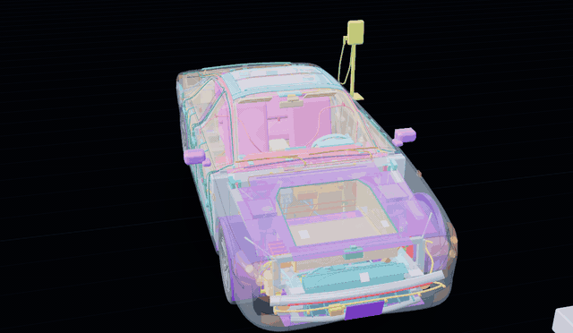
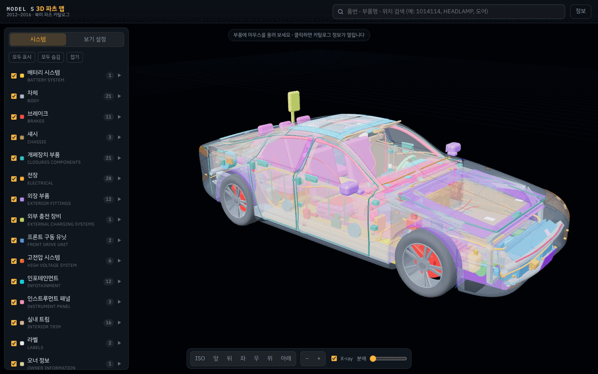
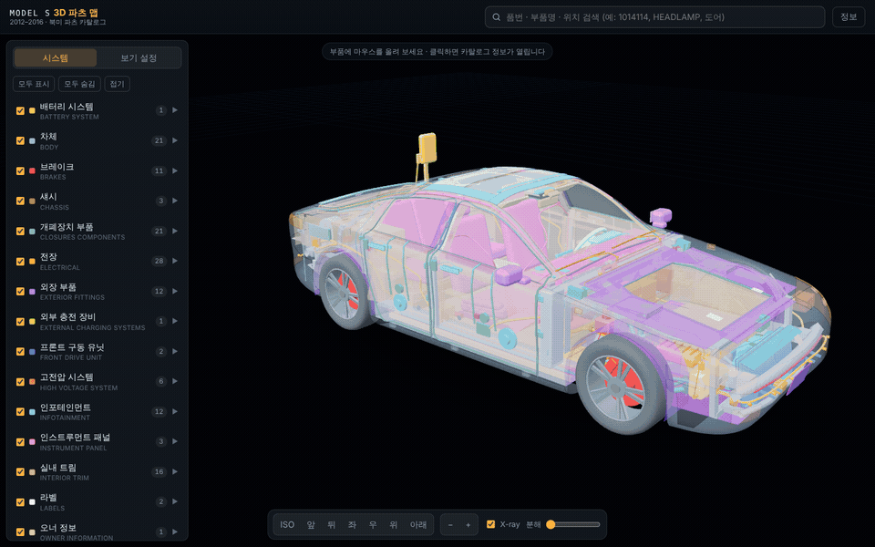
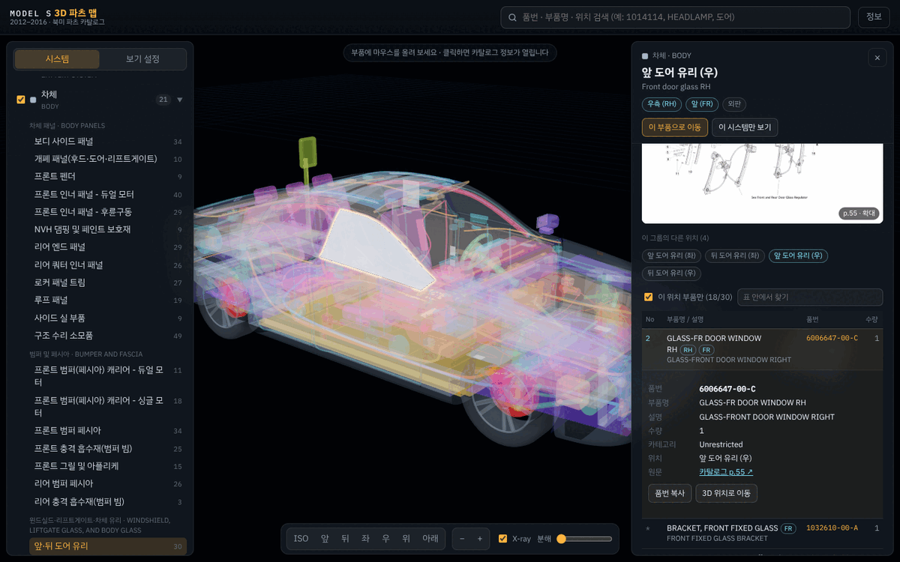
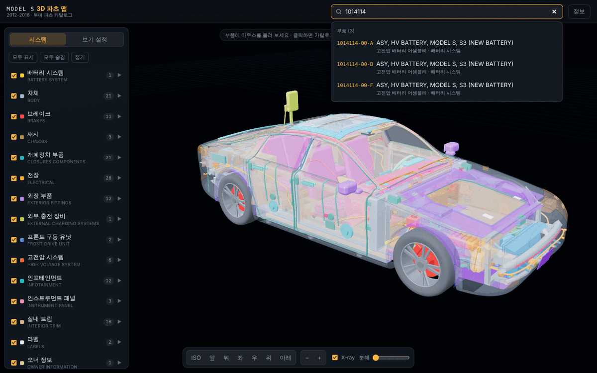
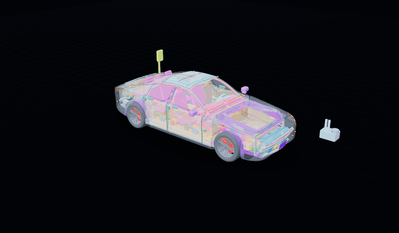
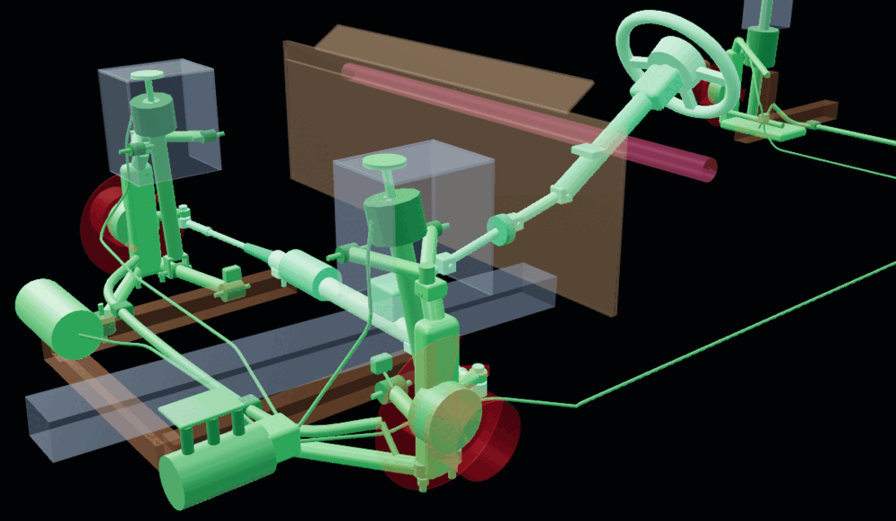
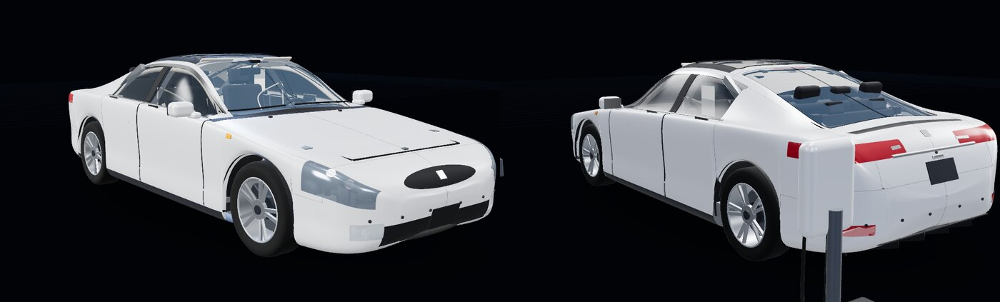
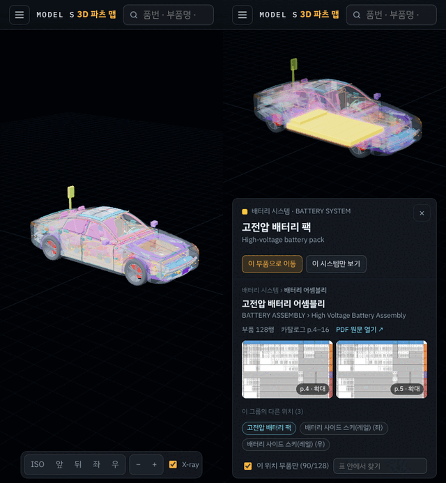

# Model S 3D 파츠 맵 (2012–2016, 북미 카탈로그)

`model_s_partsGuide-NA-2012-2016.pdf`(394쪽, 2018-02-15판)를 파싱해,
카탈로그의 **시스템 → 서브시스템 → 그룹 → 부품** 구조를 차량에서 실제로 쓰이는 위치에 배치한 인터랙티브 3D 지도입니다.



- 23개 시스템 · 213개 그룹(분해도) · 4,770개 부품 행(고유 품번 3,693개)
- 351개 3D 위치(컴포넌트). **213개 그룹 전부**가 1곳 이상에 배치되어 있습니다.
- 확대/축소·회전·이동, 마우스오버/클릭 시 대상은 선명하게, 나머지는 반투명하게 표시
- 클릭한 부품의 카탈로그 정보(그룹, 품번, 수량, 비고, 원문 페이지, 분해도 이미지)를 패널에 표시
- 서로 체결되는 부품은 실제로 맞닿게 배치하고 **444개 체결 지점**을 자동 검사합니다(볼트·부싱·볼조인트·브래킷·배관과 하네스 끝단).
  여러 그룹에 함께 실린 부품(예: 스티어링 I-샤프트 하부 링크, 4방향 냉각수 밸브)은 한 위치로 그려 두 그룹 모두에서 같은 부품을 가리킵니다.

## 만든 이유: 소유 차량 DIY 정비

제가 타는 2015년식 Model S를 직접 정비(DIY)하면서 쓰려고 만든 개인 도구입니다.

부품 하나를 찾으려면 394쪽짜리 PDF에서 시스템과 그룹을 짐작해 넘기고, 분해도의 번호를 표의 행과 하나씩 맞춰 봐야 했습니다.
이 맵에서는 차 모형에서 부위를 누르면 그 자리에 들어가는 카탈로그 그룹, 분해도, 품번, 수량, 비고가 바로 나옵니다.
반대로 품번이나 부품명으로 검색하면 그 부품이 차의 어디에 있는지 보여 줍니다.

이런 작업을 할 때 씁니다.

- 소모품 교체 전에 품번 확인: 와이퍼 블레이드, 실내 공기 필터, 브레이크 패드, 12V 배터리
- 좌/우·앞/뒤가 다른 부품 구분: 도어 유리, 헤드램프, 서스펜션 암처럼 LH/RH·FR/RR로 나뉜 품번
- 트림 패널을 뜯기 전에 안쪽 배치 확인: 도어 트림 안의 레귤레이터·스피커·래치, 대시 뒤 HVAC 유닛 위치
- 내 차 사양에 맞는 그룹 고르기: RWD/듀얼 모터, 에어/코일 서스펜션 같은 변형 그룹

> [!WARNING]
> 주황색 고전압 케이블, 배터리 팩, 고전압 정션박스(HVJB), 충전기, DC-DC 컨버터 같은 고전압 부품과
> 에어백(SRS)은 DIY 대상이 아닙니다. 이 맵은 위치와 품번을 찾는 참고 자료이며 정비 절차를 대신하지 않습니다.
> 작업 전에는 공식 서비스 정보와 카탈로그 원문 페이지를 확인하세요.

Tesla와 관계없는 개인 프로젝트입니다. Tesla와 Model S는 Tesla, Inc.의 상표입니다.

## 화면

왼쪽은 카탈로그 시스템 트리(표시/숨김, 그룹 선택), 가운데는 3D 뷰, 아래는 시점·확대·X-ray·분해 도구입니다.



### 마우스오버·클릭 강조

부품에 마우스를 올리면 그 부품만 선명해지고 나머지는 반투명해집니다. 클릭하면 선택이 고정되고 오른쪽에 카탈로그 정보가 열리며,
표에서 행을 고르면 그 부품이 쓰이는 위치가 주황색 외곽선으로 강조됩니다.



### 정보 패널

분해도(클릭하면 확대), 카탈로그 페이지와 PDF 원문 링크, 부품 표가 나옵니다.
같은 그룹이 여러 위치에 쓰이면 클릭한 위치에 해당하는 행만 걸러 보여 줍니다.



### 품번 검색

품번(하이픈 무시), 부품명, 그룹명, 위치명으로 찾습니다. 결과를 누르면 해당 위치로 카메라가 이동합니다.



### 분해 보기

슬라이더로 부품을 바깥쪽으로 펼쳐 안쪽 배치를 봅니다.



### 시스템만 보기와 장착 부품

시스템을 골라 보면(트리 체크 해제, 정보 패널의 “이 시스템만 보기”) 보이는 부품이 장착되는 다른 시스템의 부품이 흐리게 함께 나옵니다.
예를 들어 스티어링과 서스펜션만 켜면 서브프레임, 쇼크타워, 방화벽이 흐리게 보여 암과 칼럼이 어디에 체결되는지 알 수 있습니다.
흐린 부품은 클릭되지 않으며, 보기 설정에서 끌 수 있습니다.



### 실사 재질과 모바일

보기 설정에서 시스템별 색상 대신 실사 재질로 바꿀 수 있습니다. 휴대폰에서는 정보 패널이 하단 시트로 열립니다.





## 실행

정적 파일만 있으면 됩니다(빌드 불필요, three.js는 `vendor/`에 포함되어 오프라인 동작).
ES 모듈과 `fetch`를 쓰므로 `file://`이 아니라 로컬 웹 서버로 여세요.

```bash
python3 -m http.server 8000
# 브라우저에서 http://localhost:8000/
```

GitHub Pages(브랜치 루트 배포)로도 그대로 동작합니다.

## 사용법

| 동작 | 결과 |
| --- | --- |
| 드래그 / 우클릭 드래그 / 휠 | 회전 / 이동 / 커서 위치 기준 확대·축소 (터치: 한 손가락 회전, 두 손가락 이동·핀치) |
| 마우스오버 | 해당 부품 강조 + 툴팁(위치명, 카탈로그 그룹, 관련 부품 수) |
| 클릭 | 선택 고정 + 우측 정보 패널. 빈 곳 클릭 / `Esc`로 해제 |
| 더블클릭 | 그 부품으로 카메라 이동 |
| 좌측 트리 | 시스템별 표시/숨김, 그룹 클릭 시 그 그룹이 쓰이는 모든 위치를 강조 |
| 검색(`/`) | 품번(하이픈 무시)·부품명·그룹명·위치명 검색 → 결과 클릭 시 해당 위치로 이동 |
| 정보 패널 | 그룹 탭, 분해도(클릭 확대), PDF 원문 페이지 링크, 부품 표. 행 클릭 시 그 부품이 쓰이는 3D 위치를 주황색으로 강조 |
| 보기 설정 | X-ray(외판 투명), 시스템별 색상 / 실사 재질, 분해(전개) 보기, 숨긴 시스템의 장착 부품 흐리게 표시, 차량 구성(RWD·듀얼 모터·P 듀얼 모터, 에어/코일 서스펜션, 진공/iBooster) |

선택 상태는 URL 해시(`#c.<위치 id>` 또는 `#g.<그룹 id>`)로 남아 링크로 공유할 수 있습니다.
예: `#g.front-and-rear-door-glass`, `#c.hv-battery`.

### 위치별 부품 필터

같은 그룹이 여러 위치에 쓰이면(예: “앞·뒤 도어 유리” → 4곳) 부품명의 `LH/RH/LEFT/RIGHT`, `FR/RR/FRONT/REAR` 표기와
위치별 키워드 규칙으로 **클릭한 위치에 해당하는 행만** 보여 줍니다(“이 위치 부품만” 체크 해제 시 전체 표시).
위치가 특정되지 않는 볼트·클립 같은 범용 부품은 그룹의 모든 위치에 속한 것으로 처리합니다.

## 구조

```
index.html                 앱 진입점 (import map → vendor/three)
src/main.js                데이터 로드 → 장면 생성 → UI 초기화
src/catalog.js             카탈로그 인덱스, 위치↔부품 매칭, 검색
src/ui/app.js              트리·검색·정보 패널·툴팁·설정
src/scene/viewer.js        렌더러, 피킹, 강조/투명 처리, X-ray, 분해, 카메라
src/scene/profile.js       차량 치수와 측면/평면 프로파일 곡선
src/scene/body.js          파라메트릭 차체 곡면(로프트) — (s, v) 좌표로 패널 분할
src/scene/parts/*.js       시스템별 3D 컴포넌트와 카탈로그 그룹 연결
src/scene/joints.js        체결 지점(부품 A·B, 허용 간격, 카탈로그 콜아웃) — 검사와 장착 부품 표시에 사용
data/catalog.json          PDF에서 추출한 카탈로그 데이터
data/illustrations/*.webp  그룹별 분해도
docs/images/               README 스크린샷·GIF
tools/build_catalog.py     PDF → catalog.json + 분해도 추출
tools/check.mjs            일관성·연결 검사(그룹 배치, 체결 지점, 공유 부품, 관통)
tools/measure.mjs          검사용 형상 측정(표면 간 거리, 내부 판정, 배관 중심선)
```

각 3D 컴포넌트는 `src/scene/parts/` 안에서 다음처럼 정의됩니다.

```js
reg.add({
  id: 'door-glass-LF', ko: '앞 도어 유리 (좌)', en: 'Front door glass LH',
  groups: ['front-and-rear-door-glass'],   // 연결된 카탈로그 그룹 (첫 번째가 색상 기준)
  tags: 'LF',                              // 위치: L/R(좌우), F/B(앞뒤)
  match: /GLASS/,                          // (선택) 이 위치에 속하는 부품 행 규칙
  object: region([...], { mat: 'tintedGlass' }),
});
```

## 데이터 재생성 / 검사

```bash
pip install pdfplumber pypdf pillow
python3 tools/build_catalog.py      # data/catalog.json, data/illustrations/ 갱신 (약 1.5분)
node tools/check.mjs                # Node 18.19+ / 20.6+, 약 15초
```

`check.mjs`는 차량 구성 12가지(구동 3 × 서스펜션 2 × 부스터 2)마다 다음을 확인합니다.

- 체결 지점: `src/scene/joints.js`의 부품 쌍이 맞닿는지(간격 2 mm 이하). 행마다 근거가 되는 카탈로그 콜아웃·품번을 적어 둡니다.
- 공유 부품: 볼트·너트 같은 체결류를 뺀 같은 품번이 두 그룹에 있으면, 두 그룹에서 같은 3D 위치이거나 서로 맞닿은 위치여야 합니다.
  같은 품번이 앞·뒤 도어처럼 실제로 다른 자리에 쓰이는 경우는 사유와 함께 예외 목록에 둡니다.
- 관통: 빔·바·배관·하네스가 다른 부품 속을 10 mm 넘게 지나가지 않는지. 쇼크타워·대시 패널처럼 속이 빈 부품은 제외합니다.

PDF 원본은 같은 부품 행이 연식 열마다 반복되므로, 그룹 안에서 완전히 동일한 행은 하나로 합칩니다.
No 열의 `*`는 “일러스트 미표시”, 수량 `**`는 “필요 수량”입니다(카탈로그 범례).

## 한계

- 3D 형상은 실제 CAD 데이터가 아니라 공개 치수(전장 4,970 · 전폭 1,964 · 전고 1,445 · 축거 2,960 mm)를 기반으로
  코드로 생성한 **개략 모델**입니다. 부품 위치는 카탈로그 분해도와 일반적인 Model S 배치에 근거한 근사치입니다.
- 정비·주문 전에는 정보 패널의 “PDF 원문 열기” 링크로 해당 페이지를 반드시 확인하세요.
- 한국어 그룹명은 번역이며, 부품명·설명·비고는 카탈로그 원문(영문) 그대로입니다.
- 배관·하네스 경로와 일부 모듈 위치는 서로 겹치지 않도록 정한 근사 배치입니다. 앞 스트럿은 카탈로그대로 단순 클레비스로 그려
  하프샤프트와 겹치며, 검사에서 알려진 예외로 표시합니다.
